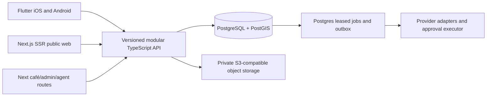

# Architecture · proposed baseline

Use a modular monolith, one API and independently runnable worker, not microservices. NestJS is the target application framework for validation/guards/OpenAPI/DI; the current Node TypeScript transport is an intentionally small disposable environment probe, not a framework replacement. Next.js beats Flutter Web for SEO and shares TypeScript contracts with dashboards. Flutter provides one native mobile codebase. PostgreSQL provides transactions, search and PostGIS indexing. Redis is deferred until measured cache/queue contention justifies operations cost. Object storage is behind an adapter with signed uploads, media rights metadata and size/type checks. Do not provision providers yet.

Modules: identity, directory, ownership, café membership, stamps, stars, tier qualification, rewards, referrals, experiences, founders, attribution, collaboration, content, notifications, agents, audit/configuration. Future commerce/education are disabled feature modules with no authority over loyalty journals.

OpenAPI-derived validated TS/Dart bootstrap/access/session DTOs and narrow TS/Dart request helpers are implemented with CI drift checks. The reviewed flat-schema generator is intentionally limited; nested business schemas/pagination need explicit generator extension or replacement before M2 APIs. Use UTC ISO-8601 instants/timestamptz; Persian/Jalali dates and numerals only at presentation. Normalize Arabic yeh/kaf, Persian digits and phones at boundaries without overwriting original source values.

Auth target: short-lived access credentials and rotating/revocable refresh sessions for mobile, HttpOnly Secure SameSite cookies with CSRF defenses for web. Hash OTPs, expire them, cap attempts and sends per identity/IP; SMS adapter disabled by default. Never treat phone possession as proof of café ownership. Tenant membership and branch scope checked on every mutation and read; do not trust submitted café IDs. Protected dashboards must remain inaccessible until real guards exist.

Implemented internal path: persistent OTP consumption, encrypted private identity, audit and opaque session insertion share one transaction. Separate stable private lookup and encryption keys avoid coupling identity to OTP key epochs. Restricted roles and non-inheriting non-owner runtime credentials isolate identity and café SQL. Café/branch HTTP reads and owner edits derive actor context from real sessions under transaction-local RLS; existing-session HTTP status/refresh/logout is available only with runtime configuration. Initial public login/provider composition, web cookie/CSRF and mobile secure token persistence remain gated integration work; no fake login is supplied. Native Android/iOS sources are checked in and built directly by pinned CI.

Transactions lock QR token and relevant journal/account/inventory rows. Validate token audience, user, café/program, expiry and authorized staff. Unique operation key scoped to actor/action plus request hash; replay of same request returns original result, changed request conflicts. Consume token, append journal, update projection, reserve/decrement stock and insert audit/outbox in one transaction. Reversals reference original entries; UPDATE/DELETE denied for journals to application role. Daily reconciliation compares projections with journal sums. Never allow negative inventory. Tier period closing writes qualification events only, never touches stars.

Search: GiST geography index for radius queries; normalized indexed names and trigram matching; explicit verified signals, freshness and capped engagement components. No paid/referral-only dominance. SSR only useful reviewed records; sitemap excludes unverified thin pages. Maps/geocoder require provider rights, local reachability and cost evaluation; no assumed free production tile service.

Local probe has no authentication, persistence or business writes and must not be publicly exposed. M1 requires migrations, secure guards, Docker development setup and actual platform builds before completion.
