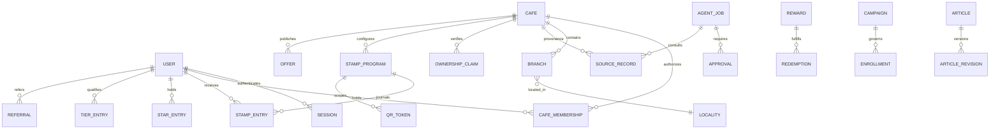

# Database model · design only, not an executed migration

UUID keys; all records have UTC timestamps. Locality has kind/province/city/parent and canonical Persian names. Branch holds address, geography(Point,4326), hours/timezone, contacts, amenities, menus, status and last verification. Café has brand identity/slug/description and ownership state. Source records retain source URL, capture/publication dates, rights status, confidence, raw hash, refresh status and field-level lineage. Photos require explicit rights status. Claims retain evidence access controls and reviewer decision.

Membership unique(user,café,branch-scope,role); server interprets café-wide scope explicitly. Journals have UUID, user, signed integer units, reason, operation_id, recorded_at, effective_at, expiry lot and reversal_of. Stamp entries additionally require program/café; tier entries require qualification period. Separate tables and FKs enforce currency boundaries. Unique operation_id per operation namespace; one reversal policy checked transactionally. Derived balances never serve as editable sources of truth.

QR tokens store hashed high-entropy nonce, consumer, café/program, expiry, consumed_at and resulting operation. Rewards store inventory and funding owner; CHECK(inventory >= 0). Redemption records reference authorizations, reward and journal operation. Referral unique(referred_user,campaign) with verified phone identity checks, risk state and unique rewarded stage. Offers cannot activate absent verified café ownership (transactional service constraint, with DB enforcement evaluated in M3).

Agent jobs: type/state/scheduled_at/lease_until/attempts/max_attempts/budget/source IDs/config version. Approval binds immutable payload hash, action, reviewer, expiry and execution id. Outbox has unique event ID and dispatched state. Audit records actor/tenant/action/reason/subject/correlation, with minimized personal data.

M1 must deliver numbered transactional migrations and clean-install/upgrade tests against PostgreSQL/PostGIS. This diagram is not proof of implemented constraints.
